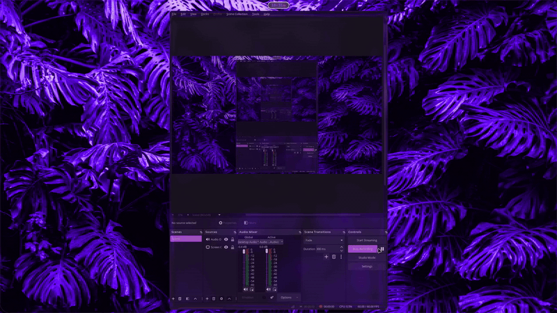

# pleamar-shell

[](showcase.mp4)

A small, animated Wayland shell for [niri](https://github.com/YaLTeR/niri), built on the [Pleamar](https://github.com/k4ditano/pleamar) engine. It combines glass surfaces, wallpaper-derived colors, and music-reactive edges in two layouts: **Island** and **Frame**.

## Features

- **Island** — a floating top bar with a clock and music-reactive edge waves.
- **Frame** — a continuous glass border with bars on every edge.
- **Launcher** — search apps, files, commands, emoji, clipboard history, wallpapers, windows, the web, and calculations.
- **Notifications** — desktop toasts and a notification center.
- **Window picker** — blurred desktop backdrop, live previews, letter shortcuts, and reveal animations.
- **Settings** — appearance, layout, font, motion, notifications, lock screen, idle, weather, and wallpapers.
- **Lock screen** — a separate PAM-backed session-lock scene.
- **Wallpaper and palette** — shader transitions with colors sampled from the current wallpaper.

## Requirements

- Linux with Wayland
- [niri](https://github.com/YaLTeR/niri)
- Nix with flakes (recommended)

## Quick start

```sh
nix build .#default
./result/bin/pleamar-shell island
```

Use `frame` instead of `island` for the frame layout:

```sh
./result/bin/pleamar-shell frame
```

For local development, the repository launcher works too:

```sh
./bin/pleamar-shell island
```

## NixOS

Add the flake input and the NixOS module:

```nix
# flake.nix
{
  inputs.pleamar-shell.url = "github:obmutescences/pleamar-shell";

  outputs = { self, nixpkgs, pleamar-shell, ... }: {
    nixosConfigurations.host = nixpkgs.lib.nixosSystem {
      system = "x86_64-linux";
      modules = [
        ./configuration.nix
        pleamar-shell.nixosModules.default
      ];
    };
  };
}
```

```nix
# configuration.nix
services.pleamar-shell = {
  enable = true;
  layout = "island"; # or "frame"
};
```

The module installs `pleamar-shell` and `pleamar-ipc` and runs the shell as a systemd user service. Remove any old niri `spawn-at-startup` entry for the shell when switching to the service.

## IPC

`pleamar-ipc` opens the shell's panels without clicking the bar:

```sh
pleamar-ipc search
pleamar-ipc settings        # optionally: settings 0..11
pleamar-ipc notifications
pleamar-ipc windows         # windows toggle for toggle
pleamar-ipc lock
pleamar-ipc wallpaper /path/to/image
```

## Configuration

Settings are stored in:

```text
~/.config/pleamar-shell/config.json
```

Use the settings panel for normal changes. Window previews, notification sounds, and wallpaper transitions are handled by helpers installed with the package.
