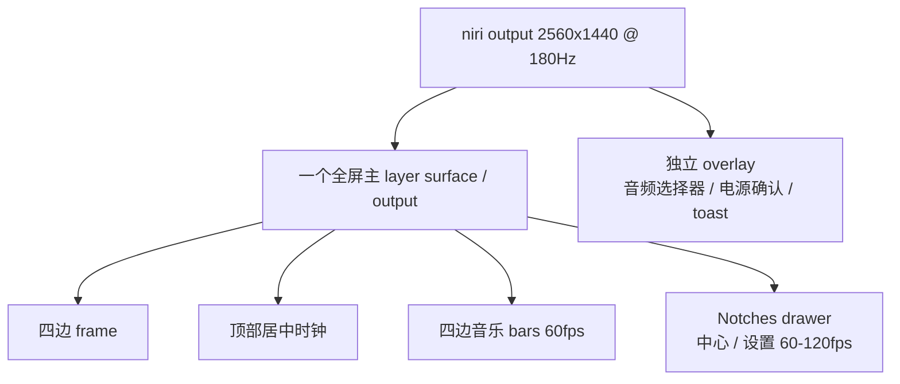

# Pleamar：Notches + 四边音乐 Frame 可行性报告

日期：2026-11-09  
范围：只做分析与方案，不修改代码。  
目标：用新的单层 Notches 模式替换现有 Island / Frame 两套 bar 模式；只保留时钟；四边 frame 与四边音乐；音乐动画 ≥60fps；音乐开启时 niri 切工作区 ≥90fps；设置中心、中心面板使用类似 Notches 时钟展开的效果。

---

## 1. 结论摘要

| 项目 | 结论 | 备注 |
|---|---|---|
| 去掉 Island / Frame，改成单一 Notches | **可行** | 建议新建 `notches` scene，验证后再删旧 mode |
| 只保留当前 Island 时钟 | **可行** | 直接复用当前 `isl_time` 的 HH:MM + 秒数字段 |
| 去掉顶部左右、左右中间、下方中间按钮 | **可行** | 这些目前是 Frame/Notches 的入口；去掉后入口集中到时钟 |
| 完整四边 glass frame | **可行** | 现有 `frame_glass` 已是全屏环形；可继续使用 |
| 音乐四边同时显示 | **可行** | 建议 12 条/边起步，共 48 条；不要一上来 96 条 |
| 音乐动画 ≥60fps | **可行** | 60fps 是 cava 的自然上限，也是推荐目标 |
| 音乐开启时 niri 切工作区 ≥90fps | **有条件可行** | 必须取消 120fps 音乐模式、减少 layer surface、控制 glass 重绘；需要原型实测 |
| 设置/中心改成 Notches 时钟展开 | **可行，但工作量中等** | 不是换个 easing 就行；要把卡片改成从 frame 长出的 drawer |
| 必须所有东西一个 layer surface 吗 | **不是 90fps 的硬条件，但主界面强烈建议一个** | 主界面一个全屏 layer；锁屏、音频选择器、通知 toast 可独立 |
| 展开动画能直接解决中心面板掉帧吗 | **不一定** | 当前中心面板掉帧的直接原因是它被 30fps 限制了 |

**一句话判断：**

> 项目可以收敛成一个“全屏单 layer 的 Notches frame + 顶部时钟 + 四边 60fps 音乐 + 从时钟长出的 drawer”。90fps+ 的工作区切换要靠“音乐时 60fps、主界面单 layer、玻璃不跟着 120fps 重绘”三件事共同保证，不能只靠换动画形状。

---

## 2. 需求拆解

### 2.1 必须保留

- 一个顶部居中的时钟。
- 当前 Island 的时间外观：时、分、秒；秒的 split-flap/缩放过渡可以保留。
- 完整四边框，四条边都有玻璃。
- 音乐播放时四条边都有音乐动画。
- 音乐动画最低 60fps。
- 音乐播放时切换 niri 工作区，整体视觉帧率不低于 90fps。
- 设置中心、中心面板打开时采用“从时钟/Notches 展开”的形态。
- 面板关闭可以反向下沉；Esc/再次点击关闭。

### 2.2 明确去掉

- Island 胶囊。
- Frame 顶栏/侧栏/底栏。
- 顶部左侧工作区/标题。
- 顶部右侧搜索、设置、控制中心、托盘。
- 左右屏幕中间的按钮。
- 下方屏幕中间的按钮。
- 除时钟外的常驻状态显示。
- 两套 layout 的选择逻辑（最终只保留一个模式）。

### 2.3 需要明确的产品决策

去掉所有入口后，以下入口必须重新指定，建议在报告通过后确认：

1. 设置中心从哪里打开：时钟 drawer 的标签页，还是时钟 drawer 内的齿轮。
2. 中心面板和设置中心是**同一个 drawer 的两个 tab**，还是两个独立的 drawer。
3. Launcher、通知中心、窗口选择器、壁纸选择器是否继续保留；它们不属于 frame，但当前由 bar/快捷键/IPC 打开。
4. 通知 toast 是否仍用独立 overlay surface；它不建议塞进主 layer。

---

## 3. 当前项目架构

### 3.1 当前有两套 scene

- `scenes/island.plm`：Island 胶囊 + 四条 `island_water` strip + settings/launcher/notifications/center。
- `scenes/frame.plm`：全屏 `frame_glass` + 四条 `frame_water` strip + settings/launcher/notifications/center。

两套 scene 都包含：

```text
modules/common/common.plm
modules/settings/panel.plm
modules/launcher/launcher.plm
modules/notifications/notifications.plm
modules/center/panel.plm
```

### 3.2 当前 layer surface 数量

按 `frame` 模式计算，音乐开启时至少有：

| Surface | 尺寸 | 当前 rate |
|---|---:|---|
| `frame_glass` | 2560×1440 | `120, 30 while quiet` |
| `frame_water_top` | 2560×120 | `120, 30 while quiet` |
| `frame_water_bottom` | 2560×120 | `120, 30 while quiet` |
| `frame_water_left` | 120×1440 | `120, 30 while quiet` |
| `frame_water_right` | 120×1440 | `120, 30 while quiet` |
| `config_panel` | 860×820 | `120, 30 while quiet` |
| `center_panel` | 1120×720 | `120, 30 while quiet` |

Island 模式没有全屏 `frame_glass`，但仍有 Island bar + 四条 water strip，共 5 个可见 layer。

**关键问题：**

`modules/common/common.plm` / `scenes/lib/shell.luau` 里的 `quiet` 只在：

```lua
local playing = truthy(fact.wave_on) and truthy(fact.music_on)
local open = truthy(fact.panel_open) or truthy(fact.launch_open)
quiet = (not playing) and (not open)
```

也就是说：

- 音乐一播放，**所有** `rate: 120, 30 while quiet` 的 surface 都升到 120fps。
- 打开设置（`panel_open`）也会把所有 surface 升到 120fps。
- 打开中心面板（`center_open`）**没有**加入 `quiet` 条件。

### 3.3 中心面板当前的直接掉帧原因

`modules/center/panel.plm`：

```plm
surface center_panel {
    size: 1120, 720
    anchor: center
    level: overlay
    open: center_open or ct_p > 0.01
    rate: 120, 30 while quiet
    keyboard: none
}
```

但 `center_open` 不在 `quiet` 的计算里。结果是：

- 打开中心面板时，`quiet` 仍可能为 true。
- `center_panel` 以 **30fps** 播放 `ct_p` 弹簧和 `PanelPop` 动画。
- `ct_p` 是 `~gentle` 弹簧，`ct_page` 是 260ms；30fps 下 260ms 只有约 8 帧，所以视觉上就是掉帧。

**结论：中心面板现在不是“动画算法不流畅”，而是被错误地锁在 30fps。**  
只把动画从 `PanelPop` 换成 Notches drawer，但不改 `quiet`，仍然会卡。

### 3.4 设置面板的 rate 是正常的

`modules/settings/panel.plm` 同样写 `rate: 120, 30 while quiet`，但 `panel_open` 会触发 `recompute_quiet()`，所以设置面板打开时 `quiet = false`，理论上是 120fps。

如果设置面板仍然感觉卡，原因更可能是：

- `PanelPop` 对整个 860×820 glass 卡片做 `scale`/`opacity`，大面积 glass/lens 重绘；
- `anim_panel` 当前是随机效果，可能选到 spin/unfold；
- 当前设置卡片是独立 overlay surface，背景 lens/backdrop 需要额外采样；
- 不是 rate 被锁 30。

---

## 4. 参考项目 Vitreus 的 Notches 机制

### 4.1 单 surface 架构

Vitreus 的整个 shell 主界面是一个：

```plm
surface { size: full, full; ... }
```

bar、notches、frame、面板 drawer、通知等都在同一个全屏 surface 内绘制。  
不是“每个 panel 一个 layer surface”。

它的音乐模式 rate：

```plm
rate: 480, 120 while bar_fps == 120 and not (media.playing and fw_on),
      60 while (media.playing and fw_on) or bar_fps == 60;
```

关键点：

- 音乐 + 音频可视化时，**整个 surface 降到 60fps**。
- 没有音乐时，才允许 120 或屏幕刷新率。
- 静态场景没有东西移动时不重绘；不是靠 12fps idle cap 省电。

### 4.2 时间/时钟的展开

Vitreus 的 Notches 顶栏中间有 clock。点击 clock 附近：

```plm
on press bar_hit { panel = if(panel == calendar, none, calendar) }
```

它打开的是 **calendar drawer**，不是 settings。  
Settings 是从底部 notch 或侧面 notch 长出的 drawer。

drawer 不是 `PanelPop` 那种简单放大：

- `dc`、`ds`、`dl` 等 `~drip` 弹簧；
- 宽度从窄开始，先快速变宽，再继续长高；
- 玻璃与 frame 通过 `blend` 融合；
- 内容用 `f1`/`fs` 等淡入；
- 同一个全屏 surface 内完成，没有新 layer surface。

### 4.3 参考项目并不是“四条边同时有音乐”

它的音频可视化布局 `fw_lay`：

```text
0 底边
1 四角扇形
2 顶边
3 左边
4 右边
```

没有“四条边同时”这个模式。  
你当前 `framewave.json` 是 `lay=0` 底边、24 列、50px；所以它现在不卡，不代表四边同时画也不卡。

不过它的实现方式仍然可以借鉴：**所有柱子都在同一个 surface 里，音乐时 60fps，不额外开 surface。**

---

## 5. 关键问题：一定要一个 layer surface 吗？

### 5.1 结论

**不是 90fps 的硬性条件，但对 Notches 主界面强烈建议“一个全屏主 layer”。**

理由：

1. **Notches 展开需要玻璃连续性**  
   drawer 要从 frame 边缘长出来，和 frame 共用玻璃、blend 和圆角。分成两个 layer 后，drawer 与 frame 的玻璃融合、边缘光、液态 neck 都很难做连续。

2. **面板动画不需要跨 surface 同步**  
   当前设置/中心是独立 overlay surface。每个 surface 有自己的 buffer、frame callback、layer 合成；动画时多个 surface 一起提交，容易出现相位差。一个 surface 只有一个时钟。

3. **减少 layer surface 数量**  
   现在音乐开启时是 5 个常驻 surface。一个全屏主 surface 可以替代 `frame_glass + 4×frame_water + 时钟 bar`。

4. **减少 120fps 的“全域升频”**  
   当前 `quiet` 一 false，所有 surface 都 120fps；一个 surface 后只需要一个 rate 条件。

### 5.2 但“所有东西一个 surface”不是必须

以下可以继续独立：

- **锁屏**：独立 scene/进程，必须独立。
- **音频输出选择器 / 电源确认**：如果需要在面板上方做真正 backdrop frost，仍建议独立 overlay。Pleamar 的 glass 只能 frost surface 后面的内容，不能 frost 同一 surface 内先画的内容。
- **通知 toast**：独立 overlay 更容易控制层级和超时；但它们不参与 frame/Notches 的玻璃连续。
- **Launcher/壁纸选择器**：可以后续再迁入主 surface；第一版不必全部塞进去。

### 5.3 推荐拓扑



推荐：

- 主 surface：`size: full, full`，`level: top, overlay while drawer open`。
- 音乐：主 surface 内 60fps。
- 面板展开：主 surface 内 120fps（仅在 drawer 动画期间），结束后回到 60/30。
- 锁屏、音频选择器、toast：独立 surface。
- **每台显示器一个主 surface**，不是全局一个跨屏 surface。

---

## 6. 四边音乐 + 90fps 工作区切换的可行性

### 6.1 性能预算

2560×1440 全屏：

```text
3.69 MP/帧 × 60 fps ≈ 221 MP/s
```

当前四条 strip 的面积：

```text
2×2560×120 + 2×120×1440 ≈ 0.96 MP
0.96 MP × 60 ≈ 58 MP/s
0.96 MP × 120 ≈ 115 MP/s
```

所以：

- **四条 strip 在 60fps 时很便宜。**
- 真正贵的是 **全屏 glass 也跟着 120fps**，以及 5 个 layer surface 同时提交。
- 一个全屏主 surface 在 60fps 的填充量约 221 MP/s；对你这张 AMD 独显可接受，但 glass/lens 不能每帧重算整屏。

### 6.2 本机现状

当前 niri 输出是 2560×1440 @ 180Hz。你观察到的“以前没有 90+，现在好像有”与 Vitreus 11/03–11/06 这批改动方向一致：

- 音乐时从 120/屏幕率降到 60；
- 12fps idle cap 被移除；
- 工作区 mark 动画不再被 12fps 限制；
- 隐藏 frame 不再随工作区 mark 每帧重建。

但本报告没有重新跑你的工作区切换基准，因此“稳定 90+”仍应作为原型验收指标，而不是既定事实。

### 6.3 能否保证 90fps+？

**有条件可以，不能只靠“改成一个 surface”保证。**

必要条件：

1. 音乐模式最高 **60fps**，不要 120fps。
2. 音乐播放时，不再让所有表面因 `quiet` 升到 120fps。
3. 主界面一个 layer；音乐 bars 在主 layer 内，不额外开 4 个 water surface。
4. frame glass 不因音乐每帧重做 lens/backdrop；frame 静态。
5. 面板 drawer 动画期间允许 120fps，但动画结束立即降回 60/30。
6. niri 自身保持 180Hz；layer surface 的 60fps 不应该限制 niri 的工作区动画。
7. 不叠加额外 120fps 的 toast/overlay。

达到这些条件后，niri 的工作区动画仍由 compositor 以 180Hz 合成；60fps 的 shell 只更新自己的 buffer。**理论上可以 ≥90fps，但必须用原型实测。**

如果实测不达标，优先检查：

- 全屏 glass 是否每帧都在重绘；
- 是否有额外 120fps 的 overlay；
- 是否四条边用了 96 条 bars 且每 bar 一个 glass body；
- 是否 `lens`/`backdrop` 在 drawer 打开时每帧采样全屏。

### 6.3 音乐动画的 60fps 上限

当前 cava 配置：

```text
framerate = 60
```

所以音乐数据本身只有 60 行/秒。  
音乐 bars 做到 120fps 只会插入弹簧插值，不会带来更多音频信息。  
**60fps 是合理目标，90fps 音乐没有必要。**

---

## 7. 推荐方案：Notches / 四边 frame

### 7.1 布局

- 全屏四边玻璃 frame，宽度沿用当前 `frame_glass` 的 10px 轨道 + 圆角转角。
- 顶部中间只有一个时钟 notch：
  - 时/分/秒；
  - 秒的 split-flap 动画保留；
  - 点击时钟打开 drawer。
- 不绘制：
  - 工作区 marks；
  - 窗口标题；
  - 搜索/设置/控制中心/托盘按钮；
  - 左右中间按钮；
  - 下方中间按钮。
- 音乐：
  - 四边各 12 条 bars，共 48 条；
  - 从 frame 内侧向内生长；
  - 使用现有 cava 的 24 个频段降采样；
  - 60fps；
  - 零高度时移出屏幕或 `show` 隐藏，不参与 glass。
- 面板：
  - 时钟点击后，从时钟 notch 向下长出 drawer；
  - drawer 内放中心面板/设置中心；
  - 关闭时反向缩回。

### 7.2 drawer 形态

建议参考 Vitreus 的几何展开，而不是 `PanelPop`：

```text
关闭：宽度 ~120，贴着 frame
打开：宽度增长到目标宽度，高度向下增长
拐角与 frame 融合（blend）
内容在 drawer 后半段淡入
关闭：反向，最后缩回 notch
```

设置中心和中心面板可以是：

- **方案 A：同一个 drawer + tabs**  
  一个时钟 drawer，内部两个 tab：Center / Settings。动画只实现一次，入口最简单。
- **方案 B：两个独立 drawer**  
  Center 从时钟 notch 向下，Settings 从另一个 notch/底部；需要重新设计入口。

推荐 **A**：入口唯一，符合“只保留时钟”的要求。

### 7.3 是否还要保留 Island / Frame 代码

建议：

1. 新建 `scenes/notches.plm`，不改旧 scene。
2. 主 surface 先只实现 frame + clock + music。
3. 验证 60fps 音乐和 90fps 工作区切换。
4. 再加 drawer / center / settings。
5. 稳定后才删除 `island` / `frame`，或保留一个 `legacy` 分支。

不要一开始就把旧模式删掉，否则无法 A/B 对比性能。

---

## 8. 设置中心/中心面板掉帧：Notches 展开能解决吗？

### 8.1 中心面板

**当前根因是 rate，不是动画形状。**

`center_open` 没有加入 `quiet`：

- `center_panel` 在 30fps 播放 `ct_p` 和 `PanelPop`；
- 260ms 只有约 8 帧；
- 换成 Notches drawer 但仍是 30fps，仍然卡。

### 8.2 设置面板

设置面板 `panel_open` 已加入 `quiet`，理论上是 120fps。  
如果它仍然卡，Notches drawer 可能改善，但原因不是“展开比 PanelPop 快”，而是：

- 不再对整张 860×820 glass 卡片做 scale；
- 不再需要独立 overlay surface 与主 surface 同步；
- 动画只改变 drawer 几何，内容淡入；
- 可以减少 backdrop/lens 的重复采样。

### 8.3 结论

- **先修 rate**：中心面板必须参与 `quiet` 或在主 surface 内根据 `center_open` 设 rate。
- **Notches 展开是结构性改善**，不是万能药。
- 只有同时满足：
  1. 单主 surface；
  2. drawer 动画 60/120fps；
  3. 不缩放整张全屏 glass；
  4. 不额外创建 overlay；
  才可能比现在更顺。

---

## 9. Vitreus 最近真正解决掉帧的优化

| Commit | 改动 | 影响 |
|---|---|---|
| `3410fdd` | frame ripple 不再默认常开，只属于音频可视化 | 以前全屏玻璃一直以 12fps 画；空闲也耗电、发热 |
| `3605da5` | bar 只在 Island 为 bass 监听音乐；Frame 布局不再无意义地跑 cava | 音乐 + 面板时全屏玻璃曾只有约 23fps |
| `6a97484` | 音乐 + 可视化时整个 surface 降到 60fps | 不再让 120/Screen 设置把音乐模式拉到 120 |
| `6bcb14c` / `6a60773` / `cfeb9e7` | workspace marks、关闭面板、bar hover 等在被 12fps cap 限制时补到全速 | 修复 400ms 动画只有约 5 帧的卡顿 |
| `8f0cf5d` | 移除 idle 12fps cap | 静止场景不画；移动的场景按实际 rate 画 |
| `1673025` | 隐藏的 top frame 三块不再读取 `sg.lr` 等值 | 工作区 mark 一动，不再每帧重建整块 frame glass |
| `e2be6ae` | 限制 `screens: each max N` 副本数量 | 多显示器不再因属性超限整块 bar 消失/重启 |
| `d4530b0` / `9bb850a` | Dashboard 时钟/ surfacing shader 只在实际需要时运行 | 修复 Dashboard 打开时 GPU 90%+ |
| `85eac6f` | 音频可视化默认高度从 150 降到 50 | 减少绘制面积 |

其中与你“音乐时切工作区”最相关的是：

1. **6a97484**：音乐时 60fps，不再 120。
2. **1673025**：切工作区时不再重建整块 frame。
3. **8f0cf5d + workspace full-rate commits**：不再用 12fps cap 限制过渡动画。
4. **3605da5**：Frame 布局不再为不可见 bass 持续绘制。

---

## 10. 迁移计划（后续实施，不在本报告改代码）

### Phase 0：基线测量

- 当前 `center_panel` 打开时记录实际 rate/帧时间。
- 当前音乐四边 + 工作区切换记录 GPU/CPU 与可见帧率。
- 用 niri 180Hz + `wf-recorder` 或 GPU 监控作为基线。

### Phase 1：单 surface 原型

- 新建 `notches` scene。
- 一个全屏主 surface：frame + 顶部时钟。
- 不含设置/中心，不含旧 water strips。
- 目标：静态、时钟、工作区切换稳定。

### Phase 2：四边音乐

- 12 条/边，60fps。
- 旧 shader `wave_on` 关闭，但代码保留。
- cava 启动条件改为 `wave_on or notches_music_on`。
- 目标：音乐开启时切工作区 ≥90fps。

### Phase 3：Notches drawer

- 时钟点击打开中心 drawer。
- 设置作为同一 drawer 的 tab。
- 动画 60/120fps，单 surface。
- 关闭时反向。

### Phase 4：清理

- 旧 Island/Frame 保留到新模式验收后。
- 验收后删除旧 mode 与不再使用的 surface。
- 更新 README/IPC/NixOS module layout 枚举。

---

## 11. 风险与未验证项

| 风险 | 说明 | 缓解 |
|---|---|---|
| 单 surface 全屏填充 | 2560×1440 每帧都要合成 | 60fps、静态 frame、避免全屏 lens |
| glass 无法 frost 同 surface 内容 | 音频选择器/确认框需要独立 overlay | 保留少量独立 surface |
| 输入区域 | 全屏透明 surface 不能挡住桌面点击 | 只对 UI zone 设 input region；实测 |
| 键盘焦点 | 单 surface 内 panel 需要 on-demand 键盘 | 保留现有 helper/on-demand |
| layer 层级 | frame + drawer 与通知/锁屏层级 | 主 surface `top, overlay while drawer`；锁屏独立 |
| 工作区 90fps 非保证 | 取决于 GPU/合成器/玻璃成本 | 原型实测；基线/逐步优化 |
| 96 条 bars 的 glass 成本 | 参考项目自己提到 47 个平滑 blend 形状在 iGPU 上翻倍成本 | 先 48 条，再按需增加 |
| 设置/中心内容重排 | 现有 1120×720 / 860×820 卡片要改成 drawer | 复用内容，不重写业务逻辑 |
| 引擎版本差异 | 当前项目锁 pleamar 0.7.14；Vitreus 锁 0.7.20（`17b996c` vs `f9284a1`） | 本报告没有把引擎差异归因；迁移前单独对比 changelog |

### 验证方法

1. 音乐开启，连续切换 10 次工作区。
2. 记录 niri 工作区过渡是否 ≥90fps；可用 180Hz 录屏逐帧分析，或 GPU/帧时间日志。
3. 同时观察 `center_panel` 打开时是否 60/120fps。
4. 对比：
   - 当前多 surface（基线）
   - 单 surface 60fps 音乐
   - 单 surface 60fps 音乐 + 120fps drawer
5. 检查 niri 是否仍以 180Hz 合成；60fps shell 不应限制 niri 自身动画。

---

## 12. 最终建议

**推荐做，但按以下顺序：**

1. **先修中心面板的 30fps gating**（未来实施；本报告不改代码）——这是当前中心卡顿的直接原因，成本最低。
2. **新建单 surface 的 Notches 原型**，先只放 frame + 时钟 + 四边 60fps 音乐，不急着做抽屉。
3. 验证音乐开启时切工作区 ≥90fps；如果达不到，先减少 bars/关闭全屏 glass 重绘，而不是继续加 surface。
4. 再加时钟 drawer，把中心/设置收进去；动画期间 120fps，结束后降回 60/30。
5. 最后删除 Island/Frame 旧模式。

**验收目标：**

- 音乐四边：≥60fps。
- 音乐开启时切工作区：≥90fps。
- 中心/设置打开：无 30fps 阶梯感；drawer 与 frame 连续。
- 只有一台显示器时，主界面一个 layer surface；锁屏/必要 popup 独立。
